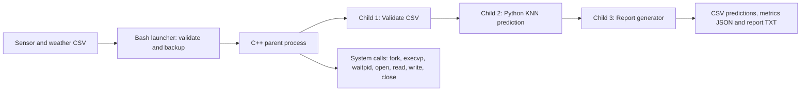

# Smart Irrigation — Operating Systems Mini-Project
**AI use case:** KJS-AGR-01 — Sugarcane Irrigation Advisory
**OS experiments:** 1, 2, 4, 5 (as numbered in the OS mini-project assignment)

> Educational demonstration only. All plots are synthetic; the KNN model learns synthetic rule-generated labels. Never use its recommendations in real farms.

## What it demonstrates

| Exp | OS integration | Working artifact |
|---|---|---|
| 1 | OS/kernel, CPU, RAM, disk, users, tool checks and basic process commands | `scripts/exp1_health_check.sh` |
| 2 | Linux directories, copying, renaming, permissions, search, counting | `scripts/exp2_file_demo.sh` |
| 4 | C++ process creation `fork/execvp/waitpid`, PID/PPID, POSIX `open/read/write/close` | `src/os_pipeline.cpp` |
| 5 | Bash variables, functions, checks, backups, errors and logs; manual exercises | `scripts/run.sh`, `scripts/exp5_manual_activities.sh` |

## Requirements
Ubuntu inside VirtualBox, `g++`, `make`, `python3`, `bash`. No Python packages or network APIs required.

Install tools only if missing:
```bash
sudo apt update
sudo apt install -y build-essential python3 make
```

## Running in Ubuntu — from the project folder

```bash
cd ~/Smart_Irrigation_OS_UseCase
chmod +x scripts/*.sh tests/*.sh
bash scripts/exp1_health_check.sh
bash scripts/exp2_file_demo.sh
bash scripts/exp5_manual_activities.sh
bash scripts/run.sh
cat outputs/advisory_report.txt
cat outputs/metrics.json
cat outputs/os_execution_summary.txt
make check
```

If ZIP unpacks into Downloads, adapt the `cd` location.

`bash scripts/run.sh data/sensor_readings.csv` also works. To test failure safely without deleting original data:
```bash
bash scripts/run.sh data/no_such_file.csv
```
It should return a nonzero exit status and log an error; missing-file handling is intentional.

## Application pipeline


The parent waits for each stage, making the workflow deterministic and preventing the report stage from reading an incomplete prediction file.

## Evidence to collect on **your own** Ubuntu VM
1. Exp 1: show `scripts/exp1_health_check.sh` and the saved `logs/exp1_system_health.txt`.
2. Exp 2: show directory creation, `chmod 640`, `ls -l`, `grep`, `find`, and `wc -l` using `scripts/exp2_file_demo.sh`.
3. Exp 4: show `make all`, output from `./build/os_pipeline data/sensor_readings.csv outputs`, and `cat outputs/os_execution_summary.txt`.
4. Exp 5: show `bash scripts/run.sh`, saved log and backup, `bash scripts/exp5_manual_activities.sh`, and a missing-file test.
5. Testing and timing: `make check`, `cat outputs/metrics.json`, `cat outputs/os_execution_summary.txt`.
6. Screenshots must be genuine. Copy results from *your* VM into the report draft, export PDF, and record the 5-minute video.

## Output files
- `outputs/predictions.csv`: per-plot educational classes and an **illustrative**, not validated duration.
- `outputs/advisory_report.txt`: human-readable plot recommendations, with safety disclaimer.
- `outputs/metrics.json`: 20% synthetic holdout classification accuracy, NOT field accuracy.
- `outputs/os_execution_summary.txt`: process duration and parent PID for each run.
- `logs/`: health checks, file-demo command output, application run logs.
- `backups/`: timestamped copies of reading input.

## Errors / troubleshooting
- `g++: command not found`: install `build-essential`.
- `python3: command not found`: install `python3`.
- `No such file or directory`: run from project folder, check file name spelling.
- `Permission denied`: use `bash scripts/run.sh` or `chmod +x scripts/run.sh`.
- CSV invalid: verify headers, number ranges, and exact permitted growth-stage spellings.

